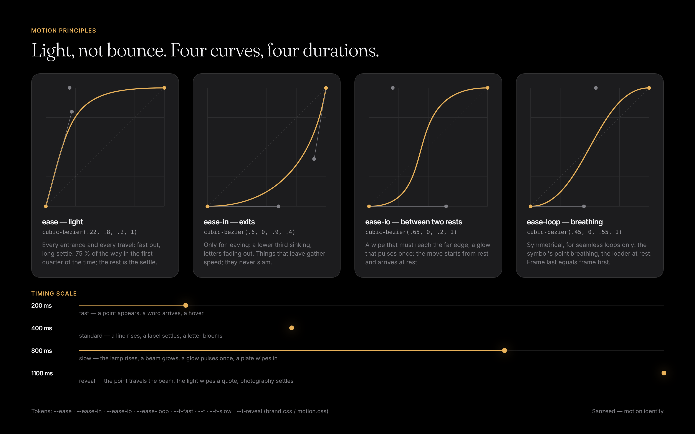

# Motion Principles — Sanzeed

The motion identity does one thing: it carries the light across. A gold point of light travels a beam through a dark room and whatever it passes is revealed. Everything else — timing, easing, transitions, the way the logo appears — follows from that image.

**Light, not bounce.** Light has no mass. It does not overshoot, spring, wobble, spin or stretch. It arrives quickly and settles slowly; it glows; it leaves without a sound.

---

## 1. Timing scale

Four durations. Nothing is set to a value outside them without a reason written in the file.

| Token | Duration | Use |
|---|---|---|
| `--t-fast` | **200 ms** | A point appears, a word arrives, a hover responds, a stroke fades after a fill |
| `--t` | **400 ms** | The standard entrance: a line rises, a label settles, a letter blooms, an element sinks out |
| `--t-slow` | **800 ms** | The lamp rises, a beam grows, a glow pulses once, a plate wipes in, a point crosses a short beam |
| `--t-reveal` | **1100 ms** | The reveal: the point travels the full beam, the light wipes a quote, photography settles |

Staggers: words 160 ms apart; lines 150 ms apart; the four steps of the route are lit when the light reaches them, not on a fixed stagger. Holds are calm: once a composition has arrived, nothing moves for at least 1.2 s before the piece ends. In a 4 s logo reveal, 1.2 s is hold; in a 6 s end card, 1.2 s is hold; in a 5 s lower third, 2.9 s is hold.

## 2. Easing curves

| Token | Curve | Character | Use |
|---|---|---|---|
| `--ease` | `cubic-bezier(.22, .8, .2, 1)` | **Light.** Fast out, long settle: 75 % of the distance in the first quarter of the time; the remaining three quarters are the settle. | Every entrance. Every travel of the point. Letters blooming. Plates settling. The default — if in doubt, this. |
| `--ease-in` | `cubic-bezier(.6, 0, .9, .4)` | Gathers speed and leaves. | Exits only: a lower third sinking, letters fading out of the outro, the beam hairline leaving. |
| `--ease-io` | `cubic-bezier(.65, 0, .2, 1)` | From rest to rest. | A move that must reach a far edge (the transition wipe), a glow that pulses once, the signature drawing on. |
| `--ease-loop` | `cubic-bezier(.45, 0, .55, 1)` | Symmetrical, sine-like. | Seamless loops only: the symbol's point breathing, the loader at rest under reduced motion. The last frame equals the first. |

In Lottie the same curves are written as keyframe handles: `--ease` is `o: {x: .22, y: .8}`, `i: {x: .2, y: 1}`; `--ease-io` is `o: {x: .65, y: 0}`, `i: {x: .2, y: 1}`. In GSAP use `CustomEase.create("sz", ".22,.8,.2,1")`; `power3.out` is the nearest built-in. In After Effects: keyframe velocity influence 22 % / 80 % out, 20 % / 100 % in.

**Why the reveal is quick and the settle is long.** On the light curve the point crosses the wordmark S → E in about 0.45 s and spends the remaining 0.65 s arriving in the counter of the D. The letters bloom behind the light over 400 ms each, so the eye reads a wave of light followed by a calm. That is the brand: the arrival is the event, not the journey.

## 3. Transitions

- **The beam wipe** is the only cut device. A 2 px Gallery White hairline with a gold glow, a 420 px gold trail behind it, crossing the frame left → right in 1100 ms on `--ease-io`. The incoming shot is clipped at the hairline. `Intros_Outros/sanzeed-transition--alpha-1920x1080.mov` (ProRes 4444) sits over the cut in any editor; the hairline is the edit point.
- **Between sections of a film:** cut to black, 400 ms of black, the beam wipe into the next shot. Never a cross-dissolve of two photographs; never a zoom, push, spin or page-peel.
- **Text replacing text:** the old line sinks (`sz-sink`, 400 ms, `--ease-in`); 200 ms of nothing; the new line rises (`sz-rise`, 400 ms, `--ease`). The two never cross-fade in place.
- **A photograph arriving:** opacity 0 → 1 with a 4 % scale-down (`sz-scale-in`, 1100 ms). Photography may settle; the logo never scales (§5).
- **On the website:** `[data-reveal]` rises 24 px and fades in over 1 s on `--ease`, once, when its top edge crosses 88 % of the viewport (`Website_Loader/sanzeed-reveal-on-scroll.css` + `.js`). Hover states transition in 200–400 ms. Nothing animates on scroll except arrival; nothing parallaxes.

## 4. Movement principles

1. **One thing moves.** A composition has one travelling element at a time — the point, the light, a line arriving. Letters, labels and lines follow the light; they do not move on their own.
2. **Left → right, top → down.** The beam always travels left to right (reading direction) or top to bottom (the lamp). Nothing enters from the right or rises from below the frame except the 24 px rise of text. Nothing moves backwards.
3. **Arrive fast, settle long.** The light curve. The first 200 ms of any entrance do most of the work; the rest is a settle the eye is allowed to rest on.
4. **Reveal by light.** Things are not "animated in"; they are lit. A letter appears because the point passed it. A quote appears because the light wiped it. A step on the route lights because the point reached it.
5. **Glow is gold and belongs to the point.** The only glow in the identity is the gold halo of a point (`--glow`, a radial gradient at 60 % → 0 %). Letters, type and photographs never glow, blur or cast coloured light. On Plaster the glow is Old Gold at a third of the strength; on print, none.
6. **Holds are calm.** When a composition has arrived, it holds. No idle motion, no floating, no shimmer, no slow zoom. The one exception is the symbol loop, where the point breathes once every 3 s — and that is the brand's heartbeat, used alone.
7. **Exits are quieter than entrances.** Leaving takes 400 ms on `--ease-in`, with a 12 px sink. Nothing flies out.
8. **Real copy, real rooms.** Motion carries the same copy and the same approved imagery as the rest of the package: wall labels on every project image, sentence-case headlines ending with a full stop, one lit last word at most.

## 5. Logo animation rules

The wordmark is the only thing in the identity that is never transformed. It may be revealed, and its points may glow; nothing else.

| Rule | Detail |
|---|---|
| **Never spin** | No rotation of any letter, dot or lockup, on any axis, including the "3D flip" and the "card turn". |
| **Never bounce** | No overshoot, elastic or spring easing on the logo. The points settle from 1.6× to 1× on `--ease`; they never spring back. |
| **Never stretch** | No non-uniform scaling, skew, perspective, liquid or morph. The uniform scale in the outro (S. growing to 2×) is the only scale permitted, and only of the symbol. |
| **The dot may glow** | The two points of light and the symbol's point may carry the gold halo, pulse once (800 ms, `--ease-io`) and, in the symbol loop, breathe. Letters never glow. |
| **The beam always travels left → right** | The travelling point leaves the S and arrives in the counter of the D. It never runs backwards; the outro removes letters by fading, not by reversing the light. Top → down is permitted for the lamp and for vertical reveals of the stacked logo. |
| **Letters are revealed, not drawn** | Letters bloom (opacity, 400 ms) behind the passing light. The wordmark is never stroke-drawn, typed, split into particles or masked with anything but a straight edge. (The hand-lettered signature, which is personal, may be stroke-drawn.) |
| **One reveal per piece** | The logo appears once. An intro reveals it; an outro collapses it to the symbol. It never loops, flashes or re-enters. |
| **Pairing and clear space hold in motion** | `full-colour-dark` on Gallery Black / Night / dark photography; `full-colour-light` on Plaster. Clear space of half the cap height is kept at every frame, including the glow. Minimum sizes as in 02_LOGO_SYSTEM. |
| **The travelling point exists only in motion** | It is the brand's "beam dot": r = 45 units (0.7 × stroke), Lamp Gold, with a 230-unit halo. It never appears in a still. |

Approved pieces: logo reveal (4 s), logo outro (3 s), symbol loop (3 s), presentation logo (4 s, alpha). New logo animation must be one of these or derived from `Source_Files/logo-reveal/index.html` with only timing changed.

## 6. Accessibility

- **Reduced motion.** Every CSS source honours `prefers-reduced-motion: reduce`: animations collapse to their end state (`motion.css`), the site's `[data-reveal]` elements are visible at once, and the loader's point breathes in place instead of travelling (`sanzeed-loader.css`). The Lottie players stop on the last frame when the preference is set. When embedding video on the site, respect the preference by showing the poster frame (`*--poster.jpg`) instead of autoplaying.
- **No flashing.** Nothing in the identity flashes faster than once per second; the single glow pulse (800 ms) and the 3 s breath are far below the 3 Hz threshold. No strobing, no full-frame flashes of light.
- **Legibility.** Text sits on ≥ 80 % black (plates at 80 % Night, bottom veils) or on Plaster; type never animates below 22 px at 1080p; the smallest type in the lower thirds is 22 px Inter. Fraunces is never set below 16 px.
- **Pace.** Words arrive 160 ms apart and a line is fully readable within 1.2 s of its first word; every piece ends on a hold long enough to read everything twice.
- **Captions and alt.** Every rendered piece has a poster frame; sources carry `aria-label`s on the inline logo and `alt` on images. Videos published on the site are silent and need no captions; if a voice is added, caption it.

## 7. Delivery specs

| Deliverable | Pixels | Length | Formats |
|---|---|---|---|
| Logo reveal | 1920×1080 dark · 1920×1080 light · 1080×1080 · 1080×1920 | 4 s | MP4 · WebM · GIF |
| Logo outro | 1920×1080 | 3 s | MP4 · WebM · GIF |
| Symbol loop | 1920×1080, transparent, seamless | 3 s | MOV ProRes 4444 alpha · WebM alpha · MP4 on black · GIF on black |
| Presentation logo | 1920×1080, transparent | 4 s | MOV ProRes 4444 alpha · WebM alpha · MP4 on black · GIF on black |
| Intro / outro | 1920×1080 · 1080×1920 | 6 s | MP4 · WebM · GIF |
| Transition | 1920×1080, transparent | 1.5 s | MOV ProRes 4444 alpha · WebM alpha · MP4 preview |
| Stories | 1080×1920 | 6 s | MP4 · GIF |
| Posts, stat counter | 1080×1080 | 5 s | MP4 · GIF |
| Lower thirds | 1920×1080, transparent | 5 s (in 1.1 · hold 2.9 · out 0.4 · 0.6 empty) | MOV ProRes 4444 alpha · WebM alpha · MP4 preview |
| Website loader | 480×48 (Lottie/SVG) · 960×120 (GIF/MP4) | 2 s loop | CSS · SVG+SMIL · Lottie JSON · GIF · MP4 |

**Codecs.** MP4: H.264 High, CRF 20, preset slow, yuv420p, faststart, 30 fps (transparent sources composited on black). WebM: VP9, CRF 30, yuva420p where transparent. MOV: ProRes 4444 (`prores_ks`, quantiser 9, Apple vendor tag), yuva444p10le, straight alpha — the master for editing; ProRes has a ~1 MB/s floor at 1080p, so transparent masters carry no lamp wash (only the points glow) to stay compact. GIF: long edge ≤ 960 px, 12–20 fps, 128-colour palette, Sierra dither, infinite loop; GIF cannot hold soft alpha, so transparent pieces are delivered on black. Frame rate is 30 fps throughout; 25 fps broadcast delivery is a re-encode from the same frames (`render.sh`, change `-framerate`).

**Loops.** The symbol loop and the loader are frame-exact loops (frame 90 = frame 0; frame 60 = frame 0). Set the player to loop; do not cross-fade the join.

**Sizes.** MP4 ≤ 8 MB, GIF ≤ 4 MB, MOV ≤ 16 MB per file (see README for the actual figures). The whole folder is under 120 MB.

**Colour.** Rec. 709, full range in the sources; H.264 and VP9 are tagged BT.709 by ffmpeg defaults. Gallery Black is true black (#000000) in video; Night #0D0D0F is used only for plates. On Plaster deliverables the accent is Old Gold #B8863B and gold text is Gold Ink #8A6124.

**Editing the sources.** Every piece is HTML + CSS `@keyframes` in `Source_Files/<name>/index.html`, with an "EDIT HERE" block at the top for copy, image and timing. Re-render with `Source_Files/render.sh` (which calls the brand kit's `capture_frames.js` for deterministic frame stepping); see `README.md`.
